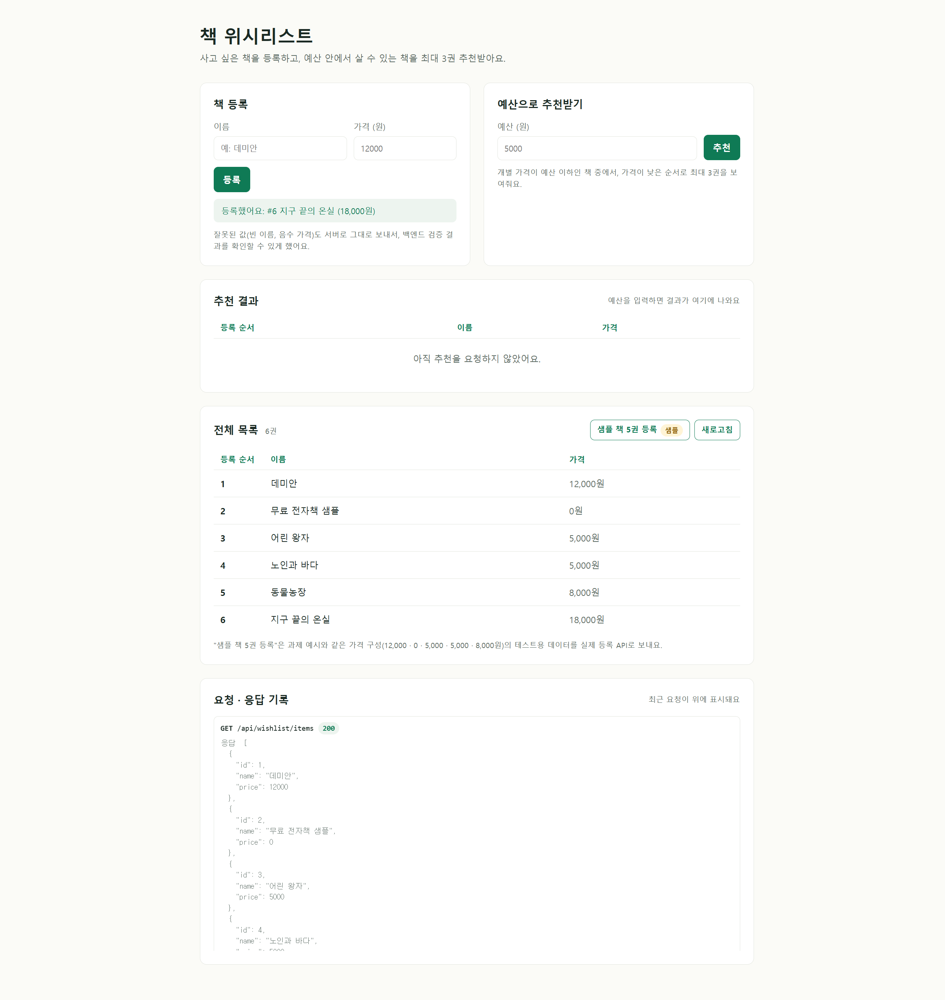
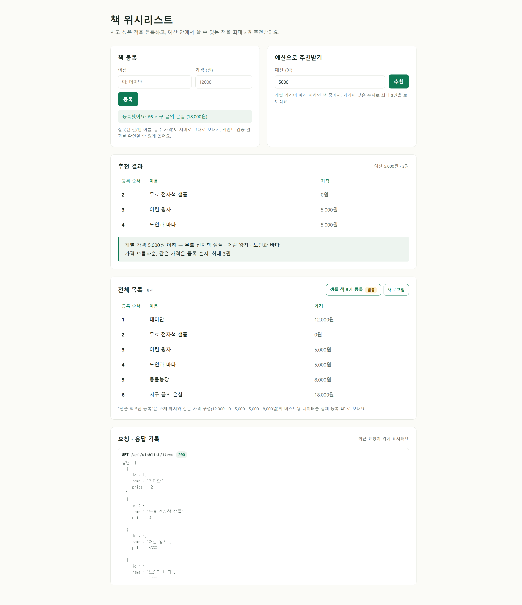
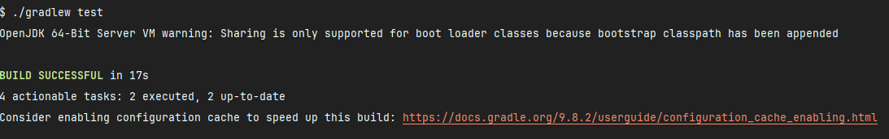

# 📚 책 위시리스트 API

사고 싶은 책을 위시리스트에 등록하고, **예산 안에서 살 수 있는 책을 최대 3권 추천**하는 Spring Boot 프로젝트입니다.

- 기술: Java · Spring Boot · Spring Web · Gradle
- 화면: 순수 HTML·CSS·JavaScript

<br>

## 화면

`http://localhost:8080/wishlist.html`

| 등록 · 전체 목록 | 예산 추천 결과 |
|---|---|
|  |  |

- **책 등록**: 이름·가격을 JSON으로 `POST` 요청, 성공하면 목록 자동 갱신
- **전체 목록**: 등록 순서(id)·이름·가격 표시
- **예산 추천**: 추천 결과 표와 요약 표시, 추천 후 전체 목록을 다시 불러와 원본 순서 유지 확인
- **요청 · 응답 기록**: 보낸 요청의 메서드·주소·요청 본문·상태 코드·응답 JSON 확인
- **샘플 책 5권 등록** `샘플`: 과제 예시와 같은 가격 구성(12,000 · 0 · 5,000 · 5,000 · 8,000원)의 테스트용 데이터를 실제 등록 API로 전송
- 빈 이름·음수 가격도 화면에서 막지 않고 서버로 보내, 백엔드 검증 결과(400 + 메시지)를 그대로 확인

<br>

## 실행 방법

```bash
./gradlew bootRun   # 서버 실행 후 http://localhost:8080/wishlist.html 접속
./gradlew test      # 전체 테스트 실행
```

<br>

## API

| 기능 | 메서드 | 주소 | 성공 | 실패 |
|---|---|---|---|---|
| 아이템 등록 | `POST` | `/api/wishlist/items` | 201 | 400 (이름·가격 규칙 위반) |
| 전체 목록 | `GET` | `/api/wishlist/items` | 200 | - |
| 단건 조회 | `GET` | `/api/wishlist/items/{id}` | 200 | 404 (없는 id) |
| 예산 추천 | `GET` | `/api/wishlist/recommendations?budget=` | 200 | 400 (음수 예산) |

<details>
<summary>요청 · 응답 예시</summary>

```http
POST /api/wishlist/items
Content-Type: application/json

{ "name": "  지구 끝의 온실  ", "price": 18000 }
```
```json
{ "id": 6, "name": "지구 끝의 온실", "price": 18000 }
```

```http
GET /api/wishlist/recommendations?budget=5000
```
```json
{
  "budget": 5000,
  "count": 3,
  "items": [
    { "id": 2, "name": "무료 전자책 샘플", "price": 0 },
    { "id": 3, "name": "어린 왕자", "price": 5000 },
    { "id": 4, "name": "노인과 바다", "price": 5000 }
  ]
}
```

실패 시 (400 Bad Request)
```json
{ "message": "이름은 비어 있을 수 없습니다." }
```
</details>

<br>

## 규칙

**등록**
- 이름: null · 빈 문자열 · 공백만 있는 이름 거부, 앞뒤 공백 제거 후 저장
- 가격: 0 이상의 정수, 0원(무료) 허용, 음수·누락 거부
- id: 프로그램이 1부터 차례로 부여
- 실패한 등록은 목록에 영향 없음 (검증을 모두 통과한 뒤에만 저장)

**추천**
- 예산은 0 이상, 음수 예산 거부
- 개별 가격이 예산 **이하**인 아이템만 후보
- 가격 오름차순, 같은 가격은 등록 순서 유지
- 최대 3개 반환, 맞는 아이템이 없으면 빈 목록
- 추천 조회가 원본 목록을 정렬·변경하지 않음

<br>

## 프로젝트 구조

```
src/main/java/com/example/wishlist
├── WishlistApplication.java
├── common
│   └── exception
│       ├── GlobalExceptionHandler.java     # 예외 → HTTP 응답 (400 / 404)
│       ├── InvalidItemException.java       # 이름·가격 규칙 위반
│       ├── InvalidBudgetException.java     # 예산 규칙 위반
│       └── ItemNotFoundException.java      # 없는 id
├── controller
│   └── WishlistController.java             # DTO ↔ model 변환, API 주소
├── dto
│   ├── ItemCreateRequest.java              # 등록 요청
│   ├── ItemResponse.java                   # 아이템 응답
│   └── RecommendationResponse.java         # 추천 응답 (budget · count · items)
├── model
│   └── WishlistItem.java                   # id · name · price
├── repository
│   ├── WishlistItemRepository.java         # 저장소 인터페이스
│   └── WishlistItemRepositoryImpl.java     # 메모리 구현
└── service
    └── WishlistService.java                # 검증 · 조회 · 추천 규칙

src/main/resources/static
└── wishlist.html                           # 프론트 화면

src/test/java/com/example/wishlist
├── WishlistApplicationTests.java           # 통합 테스트
├── repository
│   └── WishlistItemRepositoryImplTest.java # 저장소 단위 테스트
└── service
    └── WishlistServiceTest.java            # 서비스 단위 테스트
```

**요청 흐름**
```
요청 JSON → ItemCreateRequest → Controller → Service → WishlistItem → Repository
응답 JSON ← ItemResponse      ← Controller ← Service ← WishlistItem
```

<br>

## 설계 포인트

**1. Repository 인터페이스와 메모리 구현 분리**<br/>
Service는 `WishlistItemRepository` 인터페이스에만 의존합니다. 저장 방식을 DB로 바꿔도 구현체만 교체하면 되고, Service 코드는 바뀌지 않습니다.

**2. 생성자 주입**<br/>
Service는 생성자로 Repository를 받습니다. Spring은 메모리 구현 빈을 넣어 주고, 단위 테스트에서는 `new WishlistService(new WishlistItemRepositoryImpl())`처럼 Spring 없이 바로 테스트할 수 있습니다.

**3. 추천 조회가 원본을 바꾸지 않는 이유** <br/>
- `WishlistItem`의 필드를 모두 `final`로 두어, 만든 뒤에는 값이 바뀌지 않음
- `findAll()`은 내부 저장소가 아닌 **수정 불가능한 복사본**(`List.copyOf`)을 반환
- `stream().sorted()`는 원본을 정렬하지 않고 새 결과를 만들며, 안정 정렬이라 같은 가격의 등록 순서가 유지됨

**4. DTO 분리 (`record` 사용)**<br/>
요청·응답 모양은 `dto` 패키지가 정하고, Service는 model만 다룹니다. model이 바뀌어도 API 응답 형식은 유지됩니다. DTO는 데이터 전달만 하므로 생성자·접근 메서드·`toString`이 자동으로 생기고 값을 바꿀 수 없는 `record`를 사용했습니다.

**5. 직접 만든 예외로 실패 이유 구분** <br/>
`IllegalArgumentException` 대신 실패 이유가 이름에 드러나는 예외를 만들고, `GlobalExceptionHandler`에서 상태 코드로 변환합니다.

| 예외 | 상황 | 응답 |
|---|---|---|
| `InvalidItemException` | 빈 이름, 음수·누락 가격 | 400 |
| `InvalidBudgetException` | 음수 예산 | 400 |
| `ItemNotFoundException` | 없는 id 조회 | 404 |

**6. 확장을 고려한 이름**
과제 주제는 책이지만, 다른 수집 대상으로 넓힐 수 있도록 클래스 이름은 `WishlistItem` · `WishlistService`처럼 일반적으로 짓고, 책은 테스트·샘플 데이터로만 사용했습니다.

<br>

## 테스트



총 21개 테스트 통과 (`./gradlew test`)

| 구분 | 파일 | 개수 | 확인 내용 |
|---|---|---|---|
| 서비스 단위 | `WishlistServiceTest` | 15 | 등록·조회·실패·추천 규칙 전체 |
| 저장소 단위 | `WishlistItemRepositoryImplTest` | 3 | id 순차 부여, 넘겨준 객체 불변, 저장 순서 유지 |
| 통합 | `WishlistApplicationTests` | 3 | Spring이 연결한 빈으로 Repository 주입·Service 흐름·Controller DTO 응답 |

<details>
<summary>서비스 단위 테스트 상세</summary>

- **정상**: 실제 id로 단건 조회, 등록 순서대로 목록 조회, 이름 앞뒤 공백 제거, 0원 등록
- **실패**: null·빈·공백 이름 거부, 음수·null 가격 거부, 음수 예산 거부, 실패 후 목록 유지, 없는 id 예외
- **추천** (12,000 · 0 · 5,000 · 5,000 · 8,000원 데이터)
    - 예산 5,000원 → 무료 전자책 샘플 · 어린 왕자 · 노인과 바다 (경계값 포함, 가격순, 같은 가격은 등록순)
    - 예산 0원 → 무료 전자책 샘플
    - 예산 4,999원 → 5,000원짜리 제외
    - 후보가 4개 이상이어도 최대 3개
    - 추천 조회 전후 원본 목록 순서·내용 동일
    - 조건에 맞는 아이템이 없으면 빈 목록
</details>

<br>

## 발견한 문제와 수정 기록

| 증상 | 원인 | 수정 |
|---|---|---|
| 통합 테스트 3개 실패 `NoSuchBeanDefinitionException` | 메모리 구현체 이름을 바꾸면서 `@Repository`가 빠져 `WishlistItemRepository` 빈이 없음 | 구현체에 `@Repository` 추가 |
| 이름·가격 실패 테스트 3개 실패 `AssertionError` | `recommend()`만 새 예외로 바꾸고, 이름·가격 검증은 `IllegalArgumentException`을 그대로 던짐 | 검증 메서드도 `InvalidItemException`으로 변경 |
| 통합 테스트 3개 실패 `ExceptionHandlerMethodResolver` | `GlobalExceptionHandler`에서 같은 예외에 `@ExceptionHandler` 메서드가 두 개 연결됨 | 메서드마다 처리할 예외를 하나씩 지정 |
 파라미터가 없거나 숫자가 아니면 Service에 오기 전에 Spring이 400으로 막기 때문에, 응답 형식이 `{ "message": ... }`와 다릅니다.