# 스터디 참가 신청 QA

## 진행 방법

- 서버를 실행하고 http://localhost:8080/study.html 화면에서 직접 입력해 확인했다.
- 개발자 도구(F12) → Network 탭에서 요청 URL·Method·Status·Response를 함께 확인했다.
- 확인 범위: 신청 · 대기 · 취소 · 승격 · 정원 변경 · 실패 시 데이터 유지
- 사전 조건은 해당 요청을 보내기 직전의 명단 상태다.

---

## 1. 체크리스트

### A. 참가 신청 · 명단 조회

| # | 사전 조건 | 입력 | 기대 결과 | 실제 결과 | 통과 |
|---|---|---|---|---|---|
| A1 | 서버 시작 직후 | study.html 접속 (명단 자동 조회) | `참가자가 없습니다` | `참가자가 없습니다` ([캡처](images/01-empty-list.png)) | ✅ |
| A2 | 확정 3명(테스트1~3), 대기 1명(테스트4) | `테스트5` 신청 | 정원 초과 → 대기 2번째로 등록 | `[신청 성공] id=5 \| 테스트5 \| 대기 (대기 2번째)`, 명단 확정 3·대기 2 ([캡처](images/02-apply-waiting.png)) | ✅ |
| A3 | 정원 4, 확정 4명 | 이름 칸 비우고 신청 | 신청 실패, 명단 변화 없음 | `[신청 실패] 이름을 입력해주세요.`, 명단 4명 그대로 ([캡처](images/03-apply-empty-name.png)) | ✅ |
| A4 | 확정 3명, 대기 1명(테스트4) | `테스트4` 다시 신청 | 중복 이름 거절, 명단 변화 없음 | `[신청 실패] 이미 신청한 이름입니다: 테스트4`, 명단 그대로 ([캡처](images/04-apply-duplicate-name.png)) | ✅ |

### B. 취소 · 대기자 승격

| # | 사전 조건 | 입력 | 기대 결과 | 실제 결과 | 통과 |
|---|---|---|---|---|---|
| B1 | 확정 3명(테스트1~3), 대기 2명(테스트4·5) | id `3` (확정 테스트3) | 테스트3 삭제, 가장 먼저 신청한 대기자 테스트4 승격, 테스트5는 대기 유지 | `[취소 성공] id=3 \| 테스트3 \| 확정` / `[승격] id=4 \| 테스트4 \| 확정`, 명단 확정 3·대기 1 ([캡처](images/05-cancel-confirmed-promote.png)) | ✅ |
| B2 | 확정 3명, 대기 2명(테스트5·테스트6) | id `6` (대기 테스트6) | 테스트6만 삭제, 승격 없음, 다른 사람 상태 유지 | `[취소 성공] id=6 \| 테스트6 \| 대기`, 테스트5는 대기 그대로 ([캡처](images/06-cancel-waiting.png)) | ✅ |
| B3 | B1에서 id 3 취소 완료 | id `3` 다시 취소 | 이미 취소한 id → 실패, 명단 변화 없음 | `[취소 실패] 해당 id의 참가자가 없습니다: 3`, 명단 그대로 ([캡처](images/07-cancel-already-canceled.png)) | ✅ |
| B4 | 테스트3 취소 완료, 대기 1명(테스트5) | `테스트3` 재신청 | 재신청 허용, 새 id로 대기 등록 | `[신청 성공] id=7 \| 테스트3 \| 대기 (대기 2번째)` ([캡처](images/08-reapply-after-cancel.png)) | ✅ |
| B5 | 확정 3명, 대기 1명 | id `abc` | 숫자가 아님 → 실패, 명단 변화 없음 | `[취소 실패] id는 숫자로 입력해 주세요: abc`, 명단 그대로 ([캡처](images/09-cancel-not-number.png)) | ✅ |
| B6 | 정원 4, 확정 4명 | id `8` (없는 id) | 실패, 명단 변화 없음 | `[취소 실패] 해당 id의 참가자가 없습니다: 8`, 명단 4명 그대로 ([캡처](images/10-cancel-not-found.png)) | ✅ |

### C. 정원 변경

| # | 사전 조건 | 입력 | 기대 결과 | 실제 결과 | 통과 |
|---|---|---|---|---|---|
| C1 | 정원 3, 확정 3명, 대기 1명(테스트5) | `2` (확정 인원보다 작음) | 거절, 정원·명단 유지 | `[정원 변경 실패] 현재 확정 인원(3명)보다 작게 줄일 수 없습니다. (현재 정원 3명)`, 명단 그대로 ([캡처](images/11-capacity-reject.png)) | ✅ |
| C2 | 정원 3, 확정 3명, 대기 1명(테스트5) | `4` | 정원 3 → 4, 빈자리 1개만큼 대기자 테스트5 승격 | `[정원 변경 성공] 3명 → 4명` / `[승격] id=5 \| 테스트5 \| 확정`, 명단 확정 4·대기 0 ([캡처](images/12-capacity-increase-promote.png)) | ✅ |

### D. 화면 · Network

| # | 확인 내용 | 기대 결과 | 실제 결과 | 통과 |
|---|---|---|---|---|
| D1 | study.html 접속 | `study.html` 로드 후 `GET /study/participants` 자동 호출 | 두 요청 확인, Response `참가자가 없습니다` ([캡처](images/01-empty-list.png)) | ✅ |
| D2 | 명단 조회 요청 | `GET /study/participants`, 200 OK | Request URL·Method·Status 일치 ([캡처](images/02-apply-waiting.png)) | ✅ |
| D3 | 취소 요청 | `POST /study/cancel`, 200 OK | Request URL·Method·Status 일치 ([캡처](images/05-cancel-confirmed-promote.png)) | ✅ |
| D4 | 성공·실패 요청의 Response 탭 | 화면 처리 결과와 같은 문자열 | 모두 일치 ([정원 변경](images/12-capacity-increase-promote.png), [취소 실패](images/10-cancel-not-found.png), [신청 실패](images/04-apply-duplicate-name.png)) | ✅ |
| D5 | 요청 이후 화면 갱신 | 결과 칸 표시 + 명단 자동 갱신 (POST 뒤에 `participants` GET이 이어짐) | Network 목록에서 `cancel`·`capacity` 뒤 `participants` 확인 | ✅ |

---

## 2. 실행 결과 요약

| 영역 | 핵심 확인 | 결과 |
|---|---|---|
| 명단 조회 | 빈 명단 안내, 신청 순서대로 표시 | 통과 |
| 신청 | 정원 초과 시 신청 순서대로 대기 등록 | 통과 |
| 신청 실패 | 빈 이름·중복 이름 거절, 명단 유지 | 통과 |
| 확정자 취소 | 가장 먼저 신청한 대기자 1명만 승격 | 통과 |
| 대기자 취소 | 그 대기자만 삭제, 다른 사람 상태 유지 | 통과 |
| 취소 실패 | 이미 취소한 id·숫자 아닌 id·없는 id 거절, 명단 유지 | 통과 |
| 재신청 | 취소한 이름으로 다시 신청 시 새 id 부여 | 통과 |
| 정원 감소 | 확정 인원보다 작으면 거절, 정원·명단 유지 | 통과 |
| 정원 증가 | 빈자리만큼 대기자를 신청 순서대로 승격 | 통과 |

---

## 3. 실행 화면

**A1 · 빈 명단**
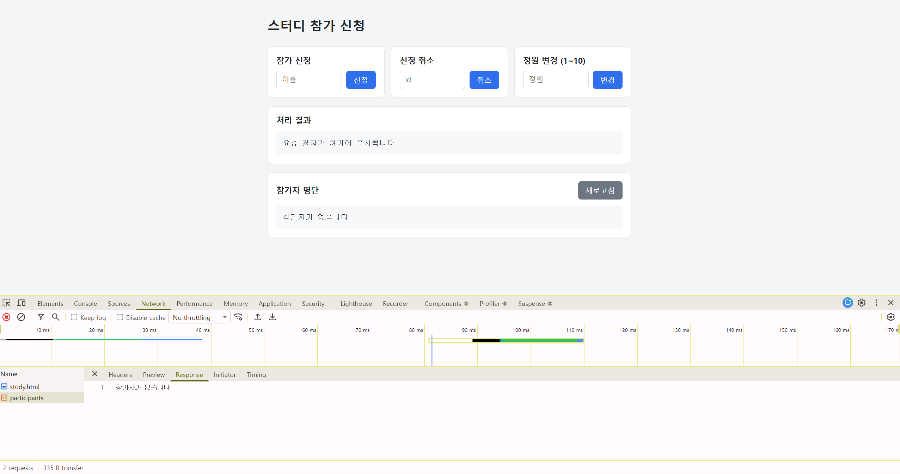

**A2 · 정원 초과 신청 → 대기 2번째**
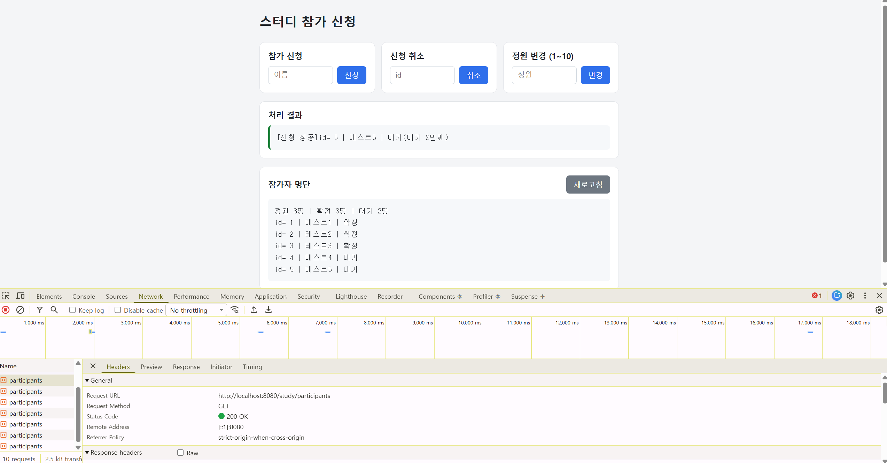

**A3 · 빈 이름 신청 → 실패**
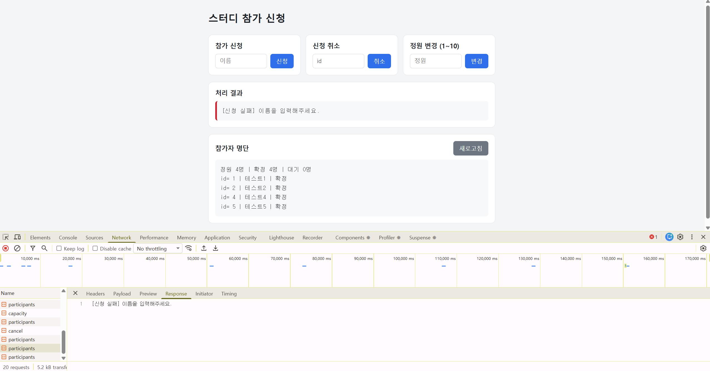

**A4 · 중복 이름 신청 → 실패**
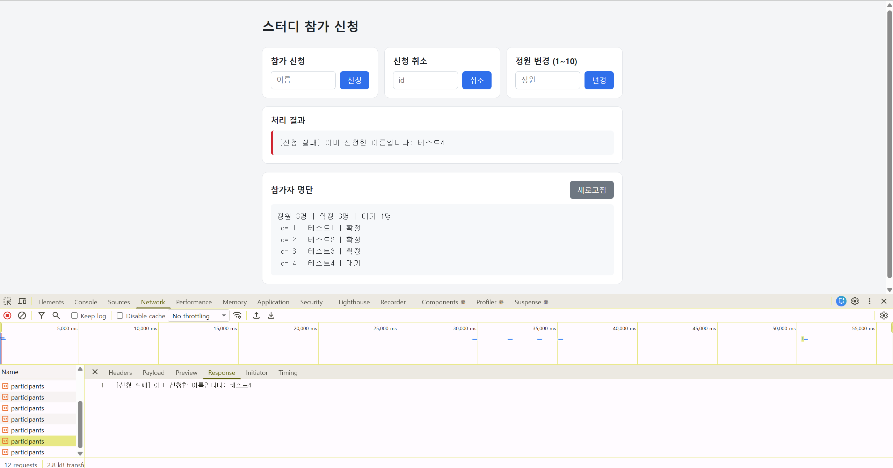

**B1 · 확정자(id=3) 취소 → 테스트4 승격**
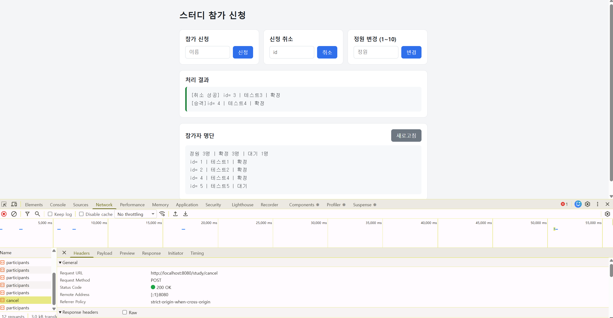

**B2 · 대기자(id=6) 취소 → 다른 사람 상태 유지**
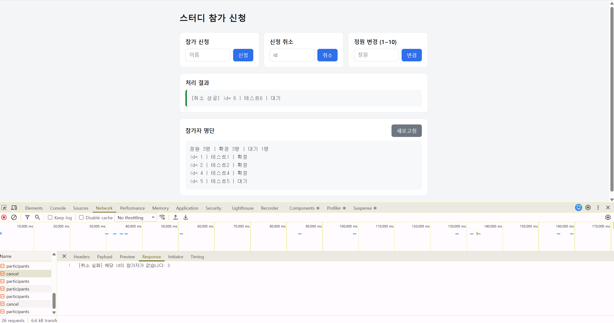

**B3 · 이미 취소한 id(3) 재취소 → 실패**
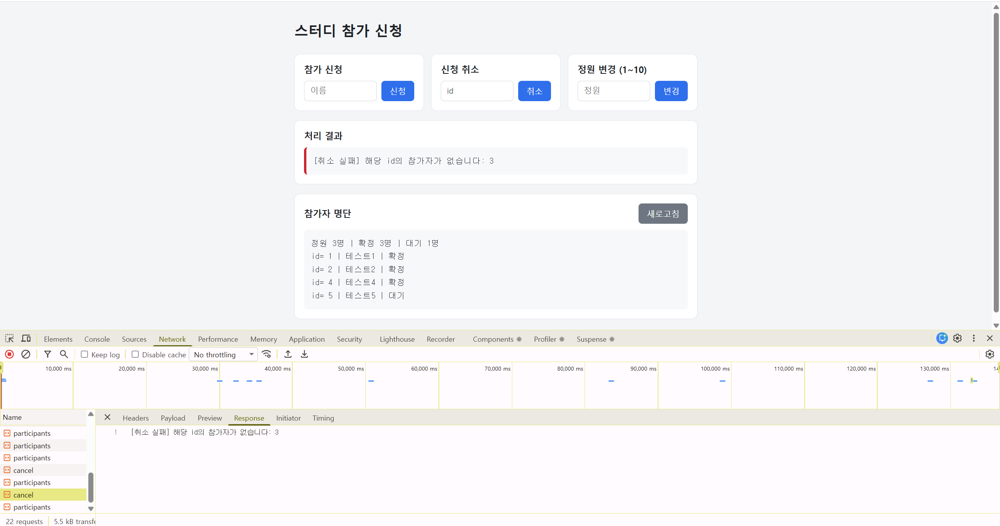

**B4 · 취소한 이름 재신청 → 새 id(7)**
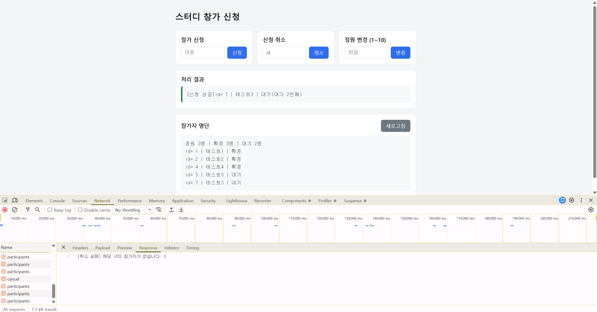

**B5 · 숫자가 아닌 id(abc) → 실패**
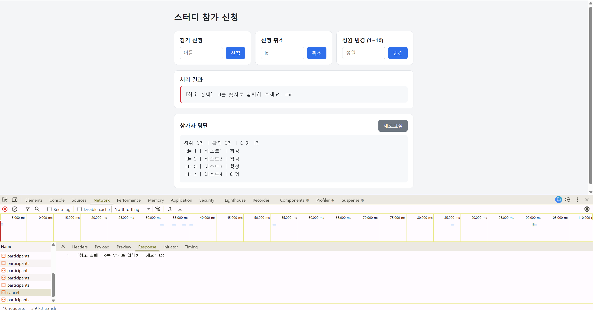

**B6 · 없는 id(8) → 실패**
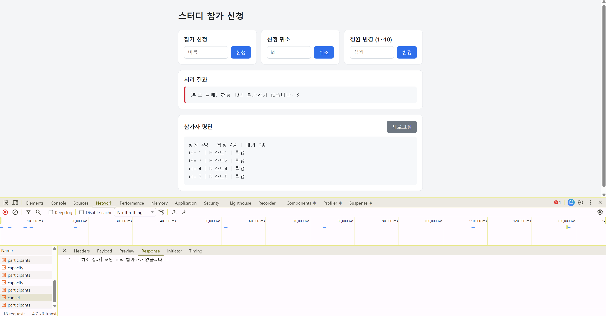

**C1 · 확정 인원보다 작은 정원 → 거절**
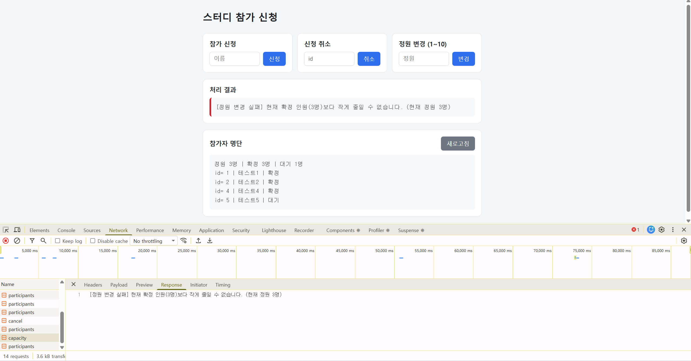

**C2 · 정원 3 → 4 → 테스트5 승격**
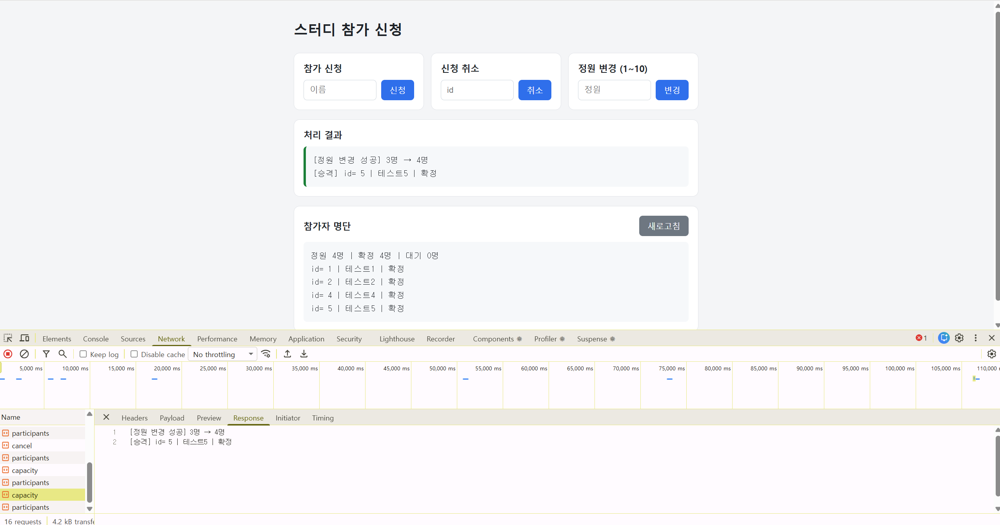